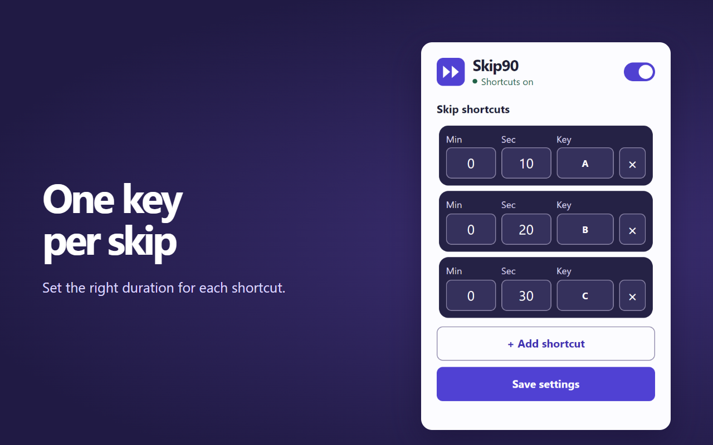

  
  <h1>Skip90</h1>
  
Tua tiến video HTML5 bằng một phím trên Google Chrome.

Mặc định, nhấn **S** để tua tiến **90 giây**. Bạn có thể gán các phím từ **A** đến **Z** cho những khoảng tua khác nhau, chẳng hạn **A** để tua 10 giây và **B** để tua 20 giây. Sau mỗi lần tua thành công, video hiển thị nhanh thời lượng thực tế đã tua, ví dụ **+1:30**.

## Cài đặt từ GitHub

Yêu cầu **Google Chrome 119 trở lên**.

1. Ở đầu trang repository, chọn **Code → Download ZIP**, rồi giải nén. Nếu đã clone repository, dùng thư mục mã nguồn trên máy.
2. Mở `chrome://extensions` trong Chrome và bật **Developer mode** (Chế độ dành cho nhà phát triển).
3. Chọn **Load unpacked** (Tải tiện ích đã giải nén), rồi chọn thư mục chứa `manifest.json`.
4. Tải lại các tab video đang mở. Bạn có thể ghim Skip90 từ menu **Tiện ích** trên thanh công cụ để mở phần cài đặt nhanh hơn.

## Sử dụng

Mở một trang có video, bấm vào trang rồi nhấn **S**. Nếu tab có nhiều video, hãy bấm vào trình phát bạn muốn tua trước khi nhấn phím. Skip90 ưu tiên video đủ điều kiện đang ở chế độ toàn màn hình.

Để thêm hoặc đổi phím tắt, mở popup Skip90 trên thanh công cụ.

1. Chọn **+ Add shortcut** và nhập thời lượng vào **Min** và **Sec**. Ô **Sec** nhận giá trị từ 0 đến 59 và tổng thời lượng phải ít nhất 1 giây.
2. Chọn **Set key**, rồi nhấn một chữ cái từ **A** đến **Z**. Mỗi chữ cái chỉ được gán một lần.
3. Chọn **Save settings** để áp dụng. Bạn có thể bấm phím đã gán để đổi, bấm **×** để xóa hoặc dùng công tắc ở đầu popup để bật hoặc tắt toàn bộ phím tắt. Chọn **Save settings** sau khi chỉnh.

## Tương thích

Skip90 hoạt động với video HTML5 trên các trang HTTP/HTTPS mà Chrome cho phép tiện ích truy cập, kể cả video nhúng trong iframe. Video trực tiếp chỉ tua được trong vùng thời gian mà trình phát cho phép. Với video gần kết thúc, khoảng tua thực tế có thể ngắn hơn cài đặt.

Nếu phím tắt không phản hồi, hãy kiểm tra trạng thái **Shortcuts on**, quyền truy cập trang của Skip90 và xem con trỏ có đang ở trong ô nhập liệu hay không. Nhấn phím chữ một lần, không kèm phím bổ trợ. Nếu trang cũng dùng phím đó, hãy gán một chữ cái khác trong Skip90.

## Quyền riêng tư

Skip90 dùng quyền `storage` để lưu trạng thái bật/tắt và danh sách phím tắt trên thiết bị. Quyền truy cập trang HTTP/HTTPS cho phép tiện ích nhận phím và tìm video cần tua, kể cả khi trình phát được nhúng từ một trang khác. Skip90 không lưu lịch sử xem hoặc gửi dữ liệu đến máy chủ.

## Tài liệu phát triển

- [Kiến trúc và cơ chế gửi thông điệp](docs/architecture.md)
- [Kế hoạch và kết quả kiểm thử](docs/test-plan.md)
- [Ghi chú triển khai](docs/implementation-notes.md)
- [Nội dung giới thiệu trên Chrome Web Store](CHROMEWEBSTORE.md)
